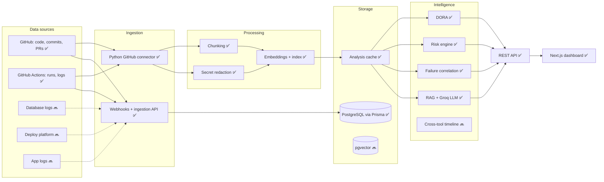

# AEIP: Presentation Slides

Slide-by-slide content for the project review. Each slide has its **content**, a suggested
**visual**, and a short **speaker note**. Numbers are measured or recorded project results unless
marked as an FF 180 assumption or a plan.

---

## Slide 1: Title

**AEIP: AI Engineering Intelligence Platform**
*One place to find out what went wrong, across every tool used to build and run software*

- Group CSA44 · Department of Computer Engineering, VIT Pune · 2026–27
- Neeraj Barhate · Anushka Bhalerao · Monali Bhujbal · Snehal Bawanthade
- Guide: Prof. Nilam Honmane · Coordinator: Dr. Ranjeetsingh Suryawanshi

---

## Slide 2: Problem statement

**When software breaks, the evidence is scattered across many tools.**

- One application uses many platforms: version control, CI/CD, database, deployment, servers, issue trackers
- Each keeps **its own logs in its own dashboard**
- The real cause often **spans tools**: code change → config or migration → deploy → failure
- Developers switch between dashboards and match timestamps by hand
- Dashboards show *what* failed, not *why*; generic AI chatbots don't know your code or logs

**Visual:** a developer in the centre, surrounded by GitHub, GitHub Actions, the database, the deploy platform and server logs, with arrows bouncing between them.
**Speaker note:** "Finding a failure today means opening five tabs and guessing how they connect."

---

## Slide 3: Why it matters

| FF 180 feasibility baseline (assumption) | Value |
|---|---|
| CI/CD failures per month, mid-sized team | 120 |
| Average manual investigation time | 45 min |
| Engineering hours lost per month | **90 h** |
| Cost at ₹1,000 per hour | **₹90,000 per month** |
| Saving if investigation time drops 40–50% | **₹36,000–45,000 per month** |

- Harder cases take a median of **4 hours** (Huang et al., 2026)
- Many CI failures are **not caused by the code change** (flaky tests, infrastructure), yet engineers still investigate them

**Speaker note:** "These are planning assumptions; measuring the real time saved is part of our end-semester evaluation."

---

## Slide 4: Proposed solution

**AEIP connects to the tools in the delivery pipeline and gives one evidence-backed answer.**

1. **Connect** version control, CI/CD, pull requests and logs (database, deploy and app logs next)
2. **Normalise** everything into one data model
3. **Correlate** failures with commits, changed files, pull requests and risk
4. **Explain** the root cause with AI, citing evidence, with a confidence level
5. **Keep a human in charge:** AEIP suggests; it never changes code or re-runs jobs

**Visual:** tool logos → funnel labelled AEIP → one answer card.
**Pitch line:** "One question, one answer, instead of five dashboards."

---

## Slide 5: Objectives (FF 180)

1. Bring GitHub, commits, PRs, issues, CI/CD, logs and docs into **one data layer**, with analytics dashboards
2. A **repository-aware RAG assistant** that answers from real code and docs, with evidence
3. **Detect and explain CI/CD failures**, with explanations and next steps, not just pass/fail
4. A **hybrid risk score**: code signals combined with LLM reasoning
5. **Empirical evaluation:** retrieval accuracy, failure-classification F1, risk effectiveness, time saved

---

## Slide 6: Literature survey

| Paper | Key idea | What it lacks (our gap) |
|---|---|---|
| SWE-bench (ICLR 2024) | Real GitHub issues as an AI benchmark | Code only; no CI or operational data |
| SWE-agent (NeurIPS 2024) | Agents navigate and fix repositories | Fixes code; doesn't investigate failures |
| A3-CodGen (IEEE TSE 2024) | Repository context improves generation | Generation only, no diagnosis |
| GraphCoder (ASE 2024) | Code-graph retrieval | Completion only |
| RCACopilot (EuroSys 2024) | LLM root cause for cloud incidents (76.6%) | Telemetry only, **ignores code and commits** |
| Huang et al. (EMSE 2026) | Is a build failure related to my patch? | **Yes/no only**, no explanation |
| Nagappan & Ball (ICSE 2005) | Code churn predicts defects | Purely statistical |
| Gao et al. (2023) | RAG survey | Not applied to engineering logs |

---

## Slide 7: Research gap

1. **No unified system:** code, CI and incident data are handled by separate tools
2. **Risk is statistical *or* AI**, never both, explainably
3. **Failure classification stops at yes/no:** no explanation or next steps
4. **Root-cause tools ignore code:** no link to commits, PRs or files
5. **RAG isn't applied to engineering data** such as CI logs and change history

**AEIP's position:** cross-tool correlation + code-grounded retrieval + explainable hybrid (rules + LLM) reasoning.

---

## Slide 8: Features

| Feature | What the developer gets | Status |
|---|---|---|
| Repository connection | Paste a GitHub link; the full pipeline runs | ✅ |
| Delivery health (DORA) | Deployment frequency, lead time, change failure rate, time to restore | ✅ (all 4) |
| Change risk | Riskiest production files, with every input shown | ✅ |
| CI failure explanation | Caused by the change or not: verdict, evidence, confidence, next steps | ✅ |
| Pull-request correlation | A failed run linked to the PR whose branch it built | ✅ |
| Ask the codebase (RAG) | Plain-English answers from code, docs, commits and CI history, with sources | ✅ |
| PostgreSQL storage | Commits and PRs stored via the ingestion service (Prisma) | ✅ integrated |
| Safety controls | Secrets hidden, low confidence flagged, human approval | ✅ |
| Light and dark themes | Readable on screens and projectors | ✅ |
| Deploy, app, database and alert connectors; incident timeline | Root cause across *all* tools, ranked with evidence | ✅ |
| Login and roles | GitHub sign-in; viewer / member / admin; audit log | ✅ |

---

## Slide 9: How it works

```
Connect ─► Collect & normalise ─► Correlate ─► Explain ─► Report
GitHub     chunk code & docs      failure ↔     rules +     verdict, confidence,
commits    redact secrets         commit, files LLM over    evidence, next steps
CI runs    index for search       PR, risk,     retrieved   (low confidence →
PRs, logs                         DORA          code & logs human review)
```

**Real pipeline run** on `Anushka05012/payflow-demo`: connect 0.5 s → 12 commits with per-file churn 1.9 s → 17 CI runs 0.9 s → 3 PRs 0.5 s → source and chunking 0.8 s → indexing 24 ms → risk and DORA in under 1 ms

**Speaker note:** "The key is linking events through shared IDs: the commit links code to CI, and the branch links a CI run to its pull request."

---

## Slide 10: System architecture

**Visual:** FF 180 Fig. 1 with ✅/🔜 marks, or render this diagram (paste into mermaid.live and export a PNG):



---

## Slide 11: Tech stack

| Layer | Technology |
|---|---|
| Frontend | Next.js 16, React 19, TypeScript, Tailwind CSS, Recharts |
| Intelligence service | Python 3.13: chunking, hybrid retrieval, risk, DORA, failure analysis, REST API |
| AI / LLM | Groq API, `gpt-oss-120b` (the Llama models named in FF 180 are no longer offered on Groq) |
| Ingestion and storage | Express + TypeScript, Prisma ORM, PostgreSQL (Supabase) |
| Data sources | GitHub REST API, GitHub Actions API, webhooks with HMAC verification |
| Testing | pytest (33 tests) + Node test runner (5 tests) |
| Planned | pgvector, Docker, Vercel + Render + Supabase deployment |

---

## Slide 12: Core feature: CI failure intelligence

**Question answered:** *"Was this failure caused by the code change, or by something else?"*

Collect logs → hide secrets → match errors against changed files → check infrastructure markers, config changes and the linked PR → LLM reasoning over retrieved code → verdict + confidence

**Results on the demo repository** (`Anushka05012/payflow-demo`, real GitHub Actions runs, known causes):

| Failure | Expected | AEIP verdict | Confidence |
|---|---|---|---|
| Refactor raises `KeyError` in `service.py` | Caused | **Caused by the change** (quotes the faulty line) | 89% |
| Bug in `refunds.py` on the *Support partial refunds* branch | Caused | **Caused by the change**, **linked to PR #1** | 90% |
| Deploy points at a new registry → DNS error | Caused (misconfiguration) | **Caused by the change**: a network error, but right after a config change | 75% |
| Sandbox outage on a docs-only commit | Not caused | **Not caused by the change** (infrastructure) | 88% |

- Below 60% confidence, or when rules and LLM disagree → **flagged for human review**
- **Speaker note:** "4 of 4 on a controlled repository with known root causes. These are cases, not an accuracy score; the measured F1 on a labelled set of real failures is end-semester work."

---

## Slide 13: Change risk and DORA

**Risk score (0–100)** = change frequency (40%) + lines churned (35%) + complexity growth (25%). Production code only; tests, docs and config are excluded. Based on Nagappan & Ball (ICSE 2005).

| Demo repository | Value |
|---|---|
| Deployment frequency | 3.27 per week (14 runs, last 30 days) |
| Lead time for changes | 0.3 h |
| Change failure rate | 21.43% (3 of 14 runs) |
| Riskiest file | `src/payflow/service.py`: 47 (4 changes, 286 lines, complexity +22) |

**Visual:** screenshot of the Change risk table.

---

## Slide 14: Ask the codebase (RAG)

- Hybrid retrieval: vector similarity + keyword match + file-path match, code-aware tokens (`getUserName` → get, user, name)
- Indexes code, docs, **commit history, PR history and CI failures**
- Every answer lists its sources with scores; says so when the excerpts don't contain the answer
- Example: *"What should we test before deploying payment changes?"* → answer from `docs/runbook.md` citing idempotency and retry checks
- Real project: *"How are signatures verified?"* on `pallets/itsdangerous` → cites `signer.py` → `verify_signature`

---

## Slide 15: Quality: Environment (measured)

Measured with psutil on the development laptop (12 logical cores, 15.7 GB RAM) · `scripts/measure_environment.py`

| Parameter | Measurement |
|---|---|
| CPU utilisation | 62.2% average during the query workload |
| GPU utilisation | 0%: no GPU needed |
| RAM usage | 73 MB baseline → 107 MB peak |
| Local model size | 0 MB (hash-based embeddings; LLM is hosted) |
| Indexing ("training") time | 42 ms for 79 chunks; no model training |
| Retrieval time per query | 45 ms median, 189 ms p95 (n = 50) |
| LLM answer time (Groq free tier) | 0.8–2.2 s typical; spikes up to 18.6 s |
| Energy (local, estimate) | ≈ 0.44 Wh per 1,000 offline queries |
| Storage | ≈ 150 KB per analysed repository |

**Speaker note:** "FF 180's 410 ms and 0.72 kWh figures assumed a local 8B model; we mark them unvalidated and will measure a local quantised model at end-semester."

---

## Slide 16: Quality: Safety and security

| Test | Result |
|---|---|
| SEC-04 Invalid input | ✅ rejected (validation, size limits) |
| SEC-05 Forged webhook | ✅ rejected: fixed a crash on forged short signatures; 5 tests |
| SEC-06 Secrets in logs | ✅ redacted (tested) |
| SEC-07 Prompt injection | ✅ logs and code passed as untrusted data; attack suite pending |
| SEC-09 Low-confidence AI | ✅ flagged for human review (tested) |
| SEC-10 AI remediation | ✅ suggestions only; no write access |
| SEC-01/02/03 Unauthorised access | 🔜 login and roles at end-sem |

| Safety scenario | Behaviour |
|---|---|
| No logs available | "Inconclusive", review flagged |
| Rules and LLM disagree | Confidence capped, review flagged |
| LLM down or unparseable | Retries once, then falls back to rules |
| Question not answerable | Says so; never invents |

---

## Slide 17: Quality: Sustainability, ethics and cost

**Sustainability:** modular engines behind small interfaces; data sources, LLM and vector store are swappable; 38 automated tests; 12-area maintenance plan.

**Ethics:** sources and confidence on every answer · human oversight · **ranks files, never developers** · data minimisation (vendored and lock files skipped) · open-source licences respected.

| Cost | FF 180 estimate | Actual to date |
|---|---|---|
| Cloud hosting | ₹1,000–1,200 | ₹0 (not deployed yet) |
| LLM API (Groq) | ₹800–1,500 | ₹0 (free tier) |
| Everything else | ₹0 | ₹0 |
| **Total** | **₹1,800–2,700** | **₹0** |

---

## Slide 18: SDG mapping

| SDG | Overall (1–5) | Evidence |
|---|---|---|
| **SDG 9** Industry, Innovation & Infrastructure | **4.5** | Working platform, tests, measured footprint |
| **SDG 8** Decent Work & Economic Growth | 4.0 | Less investigation toil; no developer surveillance |
| **SDG 12** Responsible Consumption & Production | 3.8 | Data minimisation, caching, secure data lifecycle |
| SDG 4 · SDG 16 | 3.5 | Cited answers; auditable, transparent AI |
| SDG 17 · SDG 10 | 3.2 · 3.0 | Open source; accessible to small teams |

- **Not directly applicable:** SDG 1, 2, 3, 5, 6, 11, 14, 15 (no contribution claimed)
- Full six-factor matrix: `docs/AEIP_Quality_and_SDG_Document.docx`

---

## Slide 19: Challenges and how we solved them

| Challenge | Solution |
|---|---|
| Telling real bugs from glitches | Rules (files in errors, infrastructure markers, config changes) + LLM; disagreement lowers confidence |
| A network error can still be the commit's fault | Infrastructure errors right after a config change are treated as misconfigurations |
| LLM hallucination | Answers only from retrieved evidence; sources shown |
| Secrets inside CI logs | Redacted before analysis or display |
| Malicious text in repositories | Passed to the LLM as untrusted data |
| LLM model availability | FF 180's Llama models disappeared from Groq; the model is a single config setting |
| Two separate ingestion prototypes | Merged: Python for analysis, TypeScript + Prisma for PostgreSQL storage |

---

## Slide 20: Progress so far

- ✅ Live GitHub analysis: commits (per-file churn and complexity), CI runs and logs, pull requests, source code
- ✅ DORA metrics, explainable risk scoring, CI failure explanation with PR linking, codebase Q&A
- ✅ PostgreSQL storage via the ingestion service; secured webhook listener
- ✅ Safety controls; **38 automated tests**
- ✅ Web dashboard: 5 modules, light and dark themes
- ✅ Quality and SDG evidence document with measured environmental data
- ✅ Demo repository with known failure causes for verification

**Speaker note:** "The correlation engine is built and proven on version control and CI/CD; the next sources plug into the same engine."

---

## Slide 21: Plan for end-semester

| Area | Work |
|---|---|
| More sources | Deployment platform, database logs and migrations, app logs; generic log-ingest API |
| Cross-tool incident timeline | One screen: events across all tools + likely root cause |
| Storage | pgvector with a stronger embedding model |
| Security | GitHub OAuth login and roles → SEC-01/02/03 |
| Deployment | Docker; Vercel + Render + Supabase |
| Analysis | 4th DORA metric (time to restore service), flaky-test detection, test coverage and dependencies in risk |
| **Evaluation** | Retrieval Recall@5 / MRR · failure-verdict F1 on ~100 labelled real failures · risk vs later bugs · time saved: tool-switching vs AEIP |
| Environment | Measure a local quantised model to validate the FF 180 energy table |

---

## Slide 22: Live demo

1. **Repositories:** analyse `Anushka05012/payflow-demo` → the pipeline log with a timing for each step
2. **Overview:** DORA metrics, CI runs per day, riskiest files
3. **Change risk:** every input to the score visible
4. **CI failures → Explain:** the four verdicts (open with `/failures?run=<id>`)
5. **Ask the codebase:** "What should we test before deploying payment changes?"
6. **A real project:** analyse `pallets/click`

**Tips:** analyse the repos before the review (results are cached, so they work without Wi-Fi); switch to the light theme for the projector.

---

## Slide 23: Expected outcomes and conclusion

- Developers get **one answer instead of five dashboards**
- Fewer wasted investigations into failures the code didn't cause
- Explainable, evidence-backed AI that people can verify
- Low cost: about ₹1,800–2,700 over the project lifecycle
- The core engine **works today** on version control and CI/CD; end-semester extends it to database, deployment and runtime logs, and **proves its value with measured results**

---

## Slide 24: References

1. C. E. Jimenez et al., "SWE-bench: Can Language Models Resolve Real-World GitHub Issues?", ICLR, 2024.
2. J. Yang et al., "SWE-agent: Agent-Computer Interfaces Enable Automated Software Engineering", NeurIPS, vol. 37, 2024.
3. D. Liao et al., "A3-CodGen: A Repository-Level Code Generation Framework for Code Reuse", IEEE TSE, 2024.
4. W. Liu et al., "GraphCoder: Enhancing Repository-Level Code Completion via Code Context Graph-Based Retrieval", ASE, 2024.
5. Y. Chen et al., "Automatic Root Cause Analysis via Large Language Models for Cloud Incidents", EuroSys, 2024.
6. A. Huang et al., "Is This Build Failure Related to My Patch? An Empirical Study of Unrelated Build Failures", Empirical Software Engineering, 2026.
7. N. Nagappan and T. Ball, "Use of Relative Code Churn Measures to Predict System Defect Density", ICSE, 2005.
8. Y. Gao et al., "Retrieval-Augmented Generation for Large Language Models: A Survey", arXiv:2312.10997, 2023.

---

## Slide 25: Thank you / Questions
